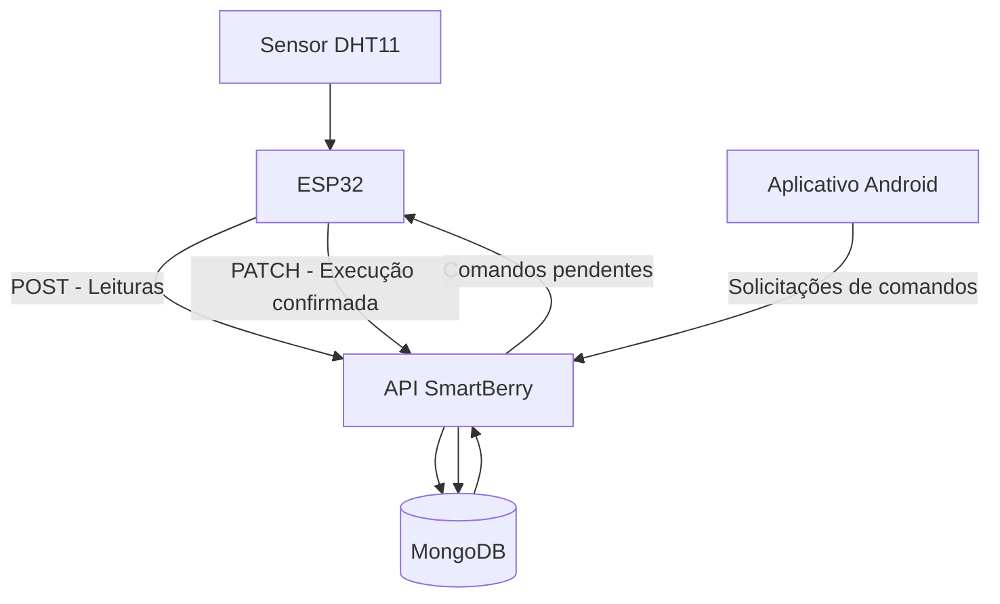

# 🍓 SmartBerry 360 — API

API REST desenvolvida para o projeto **SmartBerry 360**, uma solução de monitoramento e automação de uma estufa inteligente, integrando sensores, microcontrolador ESP32, banco de dados e aplicativo Android.

A API é responsável por receber e armazenar os dados ambientais coletados pelo sensor, disponibilizar comandos de controle para o ESP32 e acompanhar o estado de execução desses comandos.

---

## 📌 Sumário

1. [Sobre o projeto](#-sobre-o-projeto)
2. [Objetivos da API](#-objetivos-da-api)
3. [Arquitetura da solução](#-arquitetura-da-solução)
4. [Tecnologias utilizadas](#-tecnologias-utilizadas)
5. [Estrutura do projeto](#-estrutura-do-projeto)
6. [Funcionamento da comunicação](#-funcionamento-da-comunicação)
7. [Banco de dados](#-banco-de-dados)
8. [Endpoints da API](#-endpoints-da-api)
9. [Modelos de dados](#-modelos-de-dados)
10. [Validações e regras de negócio](#-validações-e-regras-de-negócio)
11. [Como executar o projeto](#-como-executar-o-projeto)
12. [Como executar os testes](#-como-executar-os-testes)
13. [Exemplos de utilização](#-exemplos-de-utilização)
14. [Tratamento de erros](#-tratamento-de-erros)
15. [Limitações e próximos passos](#-limitações-e-próximos-passos)
16. [Equipe e desenvolvimento](#-equipe-e-desenvolvimento)

---

## 🍓 Sobre o projeto

O **SmartBerry 360** é um projeto acadêmico de Internet das Coisas (IoT), desenvolvido no curso de Desenvolvimento de Software Multiplataforma (DSM) da FATEC.

A proposta consiste na construção de uma estufa inteligente em escala reduzida, utilizando sensores e automação para acompanhar condições ambientais e permitir o controle de recursos relacionados à irrigação.

A solução integra três componentes principais:

- **ESP32:** microcontrolador responsável pela comunicação com os sensores e execução dos comandos de controle.
- **API SmartBerry:** camada intermediária responsável pelo recebimento, processamento, armazenamento e disponibilização das informações.
- **Aplicativo Android:** interface de interação com o sistema, permitindo acompanhar as informações e solicitar ações de controle.

O sensor utilizado para a coleta das informações ambientais é o **DHT11**, responsável pela medição de temperatura e umidade.

Este repositório contém exclusivamente o backend da solução.

## 🎯 Objetivos da API

A API foi desenvolvida para centralizar a comunicação entre o ESP32, o banco de dados e o aplicativo Android.

Suas principais responsabilidades são:

- Receber os dados de temperatura e umidade enviados pelo ESP32.
- Registrar as leituras dos sensores no MongoDB.
- Receber solicitações de comandos de irrigação e configuração.
- Validar os comandos antes de armazená-los.
- Disponibilizar comandos pendentes para consulta pelo ESP32.
- Atualizar o status de um comando após sua execução.
- Manter os dados organizados para utilização pelos demais componentes do SmartBerry 360.

## 🏗️ Arquitetura da solução

A arquitetura utiliza uma API REST como intermediária entre o aplicativo Android e o ESP32.



### Responsabilidade de cada componente

| Componente | Responsabilidade |
|---|---|
| DHT11 | Medir temperatura e umidade do ambiente. |
| ESP32 | Coletar as leituras e executar comandos recebidos. |
| API REST | Processar requisições, aplicar regras de negócio e intermediar a comunicação. |
| MongoDB | Armazenar leituras dos sensores e comandos. |
| Aplicativo Android | Permitir a interação do usuário com o sistema. |

A comunicação entre o ESP32 e a API utiliza requisições HTTP, enquanto os dados são persistidos no MongoDB.

## 🛠️ Tecnologias utilizadas

| Tecnologia | Aplicação |
|---|---|
| Java 21 | Linguagem de programação. |
| Spring Boot 4.1.2 | Estrutura principal da aplicação backend. |
| Spring Web | Construção dos endpoints REST. |
| Spring Data MongoDB | Integração com o banco de dados. |
| MongoDB | Persistência dos dados. |
| Maven Wrapper | Gerenciamento e execução do projeto. |
| Lombok | Redução de código repetitivo. |
| Jackson | Conversão de objetos Java e JSON. |
| JUnit 5 | Testes automatizados. |
| Mockito | Simulação de dependências nos testes. |
| MockMvc | Testes de endpoints HTTP. |

## 📂 Estrutura do projeto

A aplicação segue uma organização em camadas, separando as responsabilidades de controle das requisições, regras de negócio, modelos e acesso aos dados.

```text
SmartBerryAPI/
│
├── src/
│   ├── main/
│   │   ├── java/
│   │   │   └── br/
│   │   │       └── com/
│   │   │           └── smartberry/
│   │   │               │
│   │   │               ├── SmartberryApplication.java
│   │   │               │
│   │   │               ├── controller/
│   │   │               │   ├── ControladorComandoEsp32.java
│   │   │               │   └── ControladorDadosSensor.java
│   │   │               │
│   │   │               ├── model/
│   │   │               │   ├── ComandoEsp32.java
│   │   │               │   ├── DadosSensor.java
│   │   │               │   ├── StatusComando.java
│   │   │               │   └── TipoComando.java
│   │   │               │
│   │   │               ├── repository/
│   │   │               │   ├── RepositorioComandoEsp32.java
│   │   │               │   └── RepositorioDadosSensor.java
│   │   │               │
│   │   │               └── service/
│   │   │                   ├── ServicoComandoEsp32.java
│   │   │                   └── ServicoDadosSensor.java
│   │   │
│   │   └── resources/
│   │       └── application.properties
│   │
│   └── test/
│       └── java/
│           └── br/com/smartberry/
│
├── .mvn/
├── mvnw
├── mvnw.cmd
├── pom.xml
└── README.md
```

### Organização em camadas

**Controller — Controladores**

Recebem as requisições HTTP, encaminham as informações para os serviços e retornam as respostas ao cliente.

- `ControladorDadosSensor`: recebe as leituras dos sensores.
- `ControladorComandoEsp32`: gerencia a criação, consulta e atualização dos comandos.

**Service — Serviços**

Concentram as regras de negócio da aplicação.

- `ServicoDadosSensor`: registra a data da leitura e solicita seu armazenamento.
- `ServicoComandoEsp32`: valida os comandos, define seus estados, registra a criação e atualiza sua execução.

**Repository — Repositórios**

Responsáveis pela comunicação com o MongoDB por meio do Spring Data.

- `RepositorioDadosSensor`
- `RepositorioComandoEsp32`

**Model — Modelos**

Representam as estruturas de dados utilizadas pela aplicação.

- `DadosSensor`
- `ComandoEsp32`
- `StatusComando`
- `TipoComando`

## 🔄 Funcionamento da comunicação

A comunicação de comandos utiliza o modelo de consulta periódica (*polling*).

Esse modelo permite que o ESP32 consulte a API periodicamente para verificar se existem novas instruções disponíveis.

### 1. Envio de leituras

O DHT11 realiza a medição de temperatura e umidade. O ESP32 obtém os valores e envia uma requisição HTTP para a API.

A API registra automaticamente a data e o horário de recebimento e salva a leitura no MongoDB.

### 2. Solicitação de comandos

O aplicativo Android solicita a criação de um comando por meio da API.

Antes de salvar a solicitação, o backend verifica o tipo e os valores informados.

Após a validação, o comando é armazenado com o status `PENDENTE`.

### 3. Consulta pelo ESP32

O ESP32 realiza consultas periódicas ao endpoint de comandos pendentes.

A API retorna os comandos que ainda possuem status `PENDENTE`.

### 4. Execução do comando

Ao receber um comando, o ESP32 realiza a ação correspondente, como acionar ou interromper a irrigação ou alterar o intervalo de leitura do sensor.

### 5. Confirmação da execução

Após executar a instrução, o ESP32 pode informar à API que o comando foi concluído.

A API atualiza o status para `EXECUTADO`, deixando de retornar esse comando na consulta de pendentes.

## 🗄️ Banco de dados

O projeto utiliza o **MongoDB**, um banco de dados NoSQL orientado a documentos.

A persistência é realizada por meio do Spring Data MongoDB, utilizando repositórios que estendem `MongoRepository`.

Atualmente, a aplicação trabalha com duas coleções principais:

### Coleção `dados_sensor`

Armazena as informações recebidas do sensor.

| Campo | Tipo | Descrição |
|---|---|---|
| `id` | String | Identificador do registro. |
| `temperatura` | Double | Temperatura registrada. |
| `umidade` | Double | Umidade registrada. |
| `dataRegistro` | LocalDateTime | Data e horário de recebimento. |

### Coleção `comandos_esp32`

Armazena os comandos enviados para o ESP32.

| Campo | Tipo | Descrição |
|---|---|---|
| `id` | String | Identificador do comando. |
| `tipo` | TipoComando | Tipo de ação solicitada. |
| `valor` | Integer | Parâmetro numérico do comando, quando aplicável. |
| `status` | StatusComando | Situação atual do comando. |
| `dataCriacao` | LocalDateTime | Data e horário de criação. |

Os identificadores são gerenciados pelo MongoDB, e as datas são definidas pela camada de serviço da aplicação.

## 🌐 Endpoints da API

A API disponibiliza endpoints REST para recebimento de leituras e gerenciamento de comandos.

**Endereço local padrão da aplicação:**

```text
http://localhost:8080
```

### 1. Receber dados do sensor

<kbd>POST</kbd> `/api/sensores`

Recebe os dados de temperatura e umidade enviados pelo ESP32 e registra a leitura no MongoDB.

**Corpo da requisição:**

```json
{
  "temperatura": 25.5,
  "umidade": 68.0
}
```

**Resposta esperada — 201 Created:**

```json
{
  "id": "identificador-gerado",
  "temperatura": 25.5,
  "umidade": 68.0,
  "dataRegistro": "2026-11-05T10:30:00"
}
```

A data de registro é preenchida automaticamente pela API, não sendo necessário enviá-la na requisição.

### 2. Criar comando

<kbd>POST</kbd> `/api/comandos`

Cria um novo comando para o ESP32.

O backend valida os parâmetros recebidos, define o status inicial como `PENDENTE` e registra a data de criação.

**Exemplo — acionar irrigação:**

```json
{
  "tipo": "ACIONAR_IRRIGACAO",
  "valor": 30
}
```

**Resposta esperada — 201 Created:**

```json
{
  "id": "identificador-gerado",
  "tipo": "ACIONAR_IRRIGACAO",
  "valor": 30,
  "status": "PENDENTE",
  "dataCriacao": "2026-11-05T10:30:00"
}
```

**Outros tipos de comando:**

Parar irrigação:

```json
{
  "tipo": "PARAR_IRRIGACAO"
}
```

Alterar intervalo de leitura:

```json
{
  "tipo": "ALTERAR_INTERVALO",
  "valor": 60
}
```

### 3. Consultar comandos pendentes

<kbd>GET</kbd> `/api/comandos/pendentes`

Retorna a lista de comandos que ainda possuem status `PENDENTE`.

**Exemplo de resposta — 200 OK:**

```json
[
  {
    "id": "identificador-1",
    "tipo": "ACIONAR_IRRIGACAO",
    "valor": 30,
    "status": "PENDENTE",
    "dataCriacao": "2026-11-05T10:30:00"
  },
  {
    "id": "identificador-2",
    "tipo": "ALTERAR_INTERVALO",
    "valor": 60,
    "status": "PENDENTE",
    "dataCriacao": "2026-11-05T10:32:00"
  }
]
```

Caso não existam comandos pendentes, a API retorna uma lista vazia:

```json
[]
```

### 4. Marcar comando como executado

<kbd>PATCH</kbd> `/api/comandos/{id}/executado`

Atualiza o status de um comando existente para `EXECUTADO`.

O identificador do comando deve ser informado no caminho da requisição.

**Exemplo:**

```http
PATCH /api/comandos/identificador-1/executado
```

**Resposta esperada — 200 OK:**

```json
{
  "id": "identificador-1",
  "tipo": "ACIONAR_IRRIGACAO",
  "valor": 30,
  "status": "EXECUTADO",
  "dataCriacao": "2026-11-05T10:30:00"
}
```

Caso o identificador não corresponda a um comando existente, a API retorna `404 Not Found`.

Após a atualização, o comando deixa de aparecer no endpoint de comandos pendentes.

## 📦 Modelos de dados

### TipoComando

Enum responsável por definir os tipos de comandos aceitos pela API.

| Valor | Descrição |
|---|---|
| `ACIONAR_IRRIGACAO` | Solicita o acionamento da irrigação por determinado período. |
| `PARAR_IRRIGACAO` | Solicita a interrupção da irrigação. |
| `ALTERAR_INTERVALO` | Altera o intervalo de leitura do sensor. |

### StatusComando

Enum responsável por representar a situação de execução de um comando.

| Valor | Descrição |
|---|---|
| `PENDENTE` | Comando criado e aguardando execução. |
| `EXECUTADO` | Comando marcado como executado. |

## ✅ Validações e regras de negócio

A validação dos comandos é realizada na camada `ServicoComandoEsp32`, antes da persistência no banco de dados.

### Acionar irrigação

- O campo `tipo` deve ser informado.
- O campo `valor` é obrigatório.
- A duração deve ser maior que zero.
- A duração máxima permitida é de 300 segundos.

### Parar irrigação

- O campo `tipo` deve ser informado.
- Não exige valor numérico.

### Alterar intervalo

- O campo `tipo` deve ser informado.
- O campo `valor` é obrigatório.
- O intervalo deve ser maior que zero.

### Controle de status

- Todo comando criado recebe automaticamente o status `PENDENTE`.
- A data de criação é definida pelo backend.
- Após a confirmação de execução, o comando passa para `EXECUTADO`.
- Apenas comandos pendentes são retornados na consulta específica.

## 🚀 Como executar o projeto

### Pré-requisitos

Antes de executar a aplicação, é necessário possuir:

- Java Development Kit (JDK) 21.
- Git.
- MongoDB em execução e acessível pela aplicação.
- Visual Studio Code ou outra IDE de sua preferência.

**Importante:** o projeto possui Maven Wrapper (`mvnw` e `mvnw.cmd`). Portanto, não é necessário instalar o Maven globalmente.

### 1. Clonar o repositório

```bash
git clone https://github.com/HexeSociety/SmartBerryAPI.git
```

### 2. Entrar na pasta do projeto

```bash
cd SmartBerryAPI
```

### 3. Abrir no Visual Studio Code

```bash
code .
```

### 4. Verificar a versão do Java

```bash
java -version
```

A versão utilizada no desenvolvimento é o Java 21.

### 5. Executar a aplicação

No Windows, utilize:

```powershell
.\mvnw.cmd spring-boot:run
```

No Linux ou macOS:

```bash
./mvnw spring-boot:run
```

Na primeira execução, o Maven Wrapper poderá baixar as dependências necessárias. Esse processo pode levar alguns minutos.

Após a inicialização, a API ficará disponível localmente na porta 8080, salvo configuração diferente.

### 6. Verificar a inicialização

Acompanhe o terminal e confirme que a aplicação foi iniciada sem erros.

O endereço-base local é:

```text
http://localhost:8080
```

**Observação sobre o MongoDB:** a conexão deve estar disponível para as operações de persistência. A configuração de conexão utilizada pelo ambiente deve ser definida em `application.properties` ou por variáveis de ambiente, conforme a configuração adotada para execução.

## 🧪 Como executar os testes

O projeto utiliza a estrutura de testes do Spring Boot, com suporte a JUnit 5, Mockito e MockMvc.

Para executar a suíte automatizada no Windows:

```powershell
.\mvnw.cmd clean test
```

No Linux ou macOS:

```bash
./mvnw clean test
```

Para compilar e empacotar a aplicação:

```powershell
.\mvnw.cmd clean package
```

Os testes automatizados devem verificar as regras de negócio dos serviços e o comportamento dos endpoints, incluindo respostas HTTP, validações e persistência simulada quando aplicável.

## 🔎 Exemplos de utilização

Uma sequência básica de utilização da API pode ser realizada da seguinte maneira:

**1. Registrar leitura do sensor**

Enviar `POST /api/sensores` com temperatura e umidade.

**2. Criar comando de irrigação**

Enviar `POST /api/comandos` com o tipo `ACIONAR_IRRIGACAO` e a duração desejada.

**3. Consultar comandos disponíveis**

O ESP32 realiza `GET /api/comandos/pendentes` para buscar as instruções aguardando execução.

**4. Executar a instrução**

O ESP32 interpreta o tipo de comando e realiza a ação correspondente.

**5. Confirmar execução**

Após concluir a ação, o ESP32 envia `PATCH /api/comandos/{id}/executado`.

**6. Confirmar atualização**

Uma nova consulta aos comandos pendentes não deverá retornar o comando que já foi marcado como executado.

## ⚠️ Tratamento de erros

A API utiliza códigos HTTP para indicar o resultado das operações.

| Código | Significado | Situação |
|---|---|---|
| `200 OK` | Requisição concluída. | Consulta ou atualização realizada com sucesso. |
| `201 Created` | Recurso criado. | Leitura ou comando armazenado. |
| `400 Bad Request` | Requisição inválida. | Tipo ausente ou parâmetros de comando inválidos. |
| `404 Not Found` | Recurso não encontrado. | Identificador de comando inexistente. |

As mensagens de validação são retornadas pelo controlador de comandos quando ocorre uma `IllegalArgumentException`.

## 🚧 Limitações e próximos passos

A implementação atual contempla o recebimento de dados dos sensores, a criação e consulta de comandos e a atualização do estado de execução.

Alguns pontos permanecem como evolução da solução:

- **Autenticação e autorização:** integração com Firebase Authentication para validação de tokens de acesso.
- **Expiração de comandos:** implementação de uma regra para evitar que comandos antigos permaneçam disponíveis indefinidamente.
- **Testes automatizados:** ampliação da cobertura para contemplar os novos comportamentos, incluindo a confirmação de execução e os cenários de erro.
- **Evolução do monitoramento:** ampliação dos recursos de consulta e utilização histórica das leituras ambientais.

Esses itens não devem ser considerados funcionalidades já disponíveis nesta versão.

## 👥 Equipe e desenvolvimento

O SmartBerry 360 é desenvolvido de forma colaborativa, com divisão das responsabilidades entre os integrantes da equipe.

O backend é organizado para permitir evolução incremental, separação de responsabilidades e validação contínua das funcionalidades.

**Repositório:** [GitHub — HexeSociety/SmartBerryAPI](https://github.com/HexeSociety/SmartBerryAPI)

---

**SmartBerry 360 — Tecnologia e automação para uma estufa inteligente.** 🍓