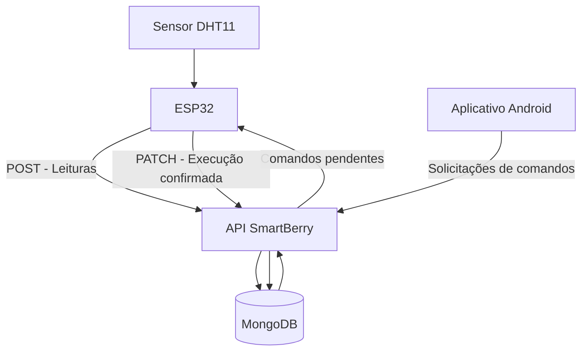

# 🍓 SmartBerry 360 — API

API REST desenvolvida para o projeto **SmartBerry 360**, uma solução de monitoramento e automação de uma estufa inteligente, integrando sensores, microcontrolador ESP32, banco de dados e aplicativo Android.

A API é responsável por receber e armazenar os dados ambientais coletados pelo sensor, disponibilizar comandos de controle para o ESP32 e acompanhar o estado de execução desses comandos.

---

## 📌 Sumário

1. [Sobre o projeto](#-sobre-o-projeto)
2. [Objetivos da API](#-objetivos-da-api)
3. [Arquitetura da solução](#-arquitetura-da-solução)
4. [Tecnologias utilizadas](#-tecnologias-utilizadas)
5. [Estrutura do projeto](#-estrutura-do-projeto)
6. [Funcionamento da comunicação](#-funcionamento-da-comunicação)
7. [Banco de dados](#-banco-de-dados)
8. [Endpoints da API](#-endpoints-da-api)
9. [Modelos de dados](#-modelos-de-dados)
10. [Validações e regras de negócio](#-validações-e-regras-de-negócio)
11. [Como executar o projeto](#-como-executar-o-projeto)
12. [Como executar os testes](#-como-executar-os-testes)
13. [Exemplos de utilização](#-exemplos-de-utilização)
14. [Tratamento de erros](#-tratamento-de-erros)
15. [Limitações e próximos passos](#-limitações-e-próximos-passos)
16. [Equipe e desenvolvimento](#-equipe-e-desenvolvimento)

---

## 🍓 Sobre o projeto

O **SmartBerry 360** é um projeto acadêmico de Internet das Coisas (IoT), desenvolvido no curso de Desenvolvimento de Software Multiplataforma (DSM) da FATEC.

A proposta consiste na construção de uma estufa inteligente em escala reduzida, utilizando sensores e automação para acompanhar condições ambientais e permitir o controle de recursos relacionados à irrigação.

A solução integra três componentes principais:

- **ESP32:** microcontrolador responsável pela comunicação com os sensores e execução dos comandos de controle.
- **API SmartBerry:** camada intermediária responsável pelo recebimento, processamento, armazenamento e disponibilização das informações.
- **Aplicativo Android:** interface de interação com o sistema, permitindo acompanhar as informações e solicitar ações de controle.

O sensor utilizado para a coleta das informações ambientais é o **DHT11**, responsável pela medição de temperatura e umidade.

Este repositório contém exclusivamente o backend da solução.

## 🎯 Objetivos da API

A API foi desenvolvida para centralizar a comunicação entre o ESP32, o banco de dados e o aplicativo Android.

Suas principais responsabilidades são:

- Receber os dados de temperatura e umidade enviados pelo ESP32.
- Registrar as leituras dos sensores no MongoDB.
- Receber solicitações de comandos de irrigação e configuração.
- Validar os comandos antes de armazená-los.
- Disponibilizar comandos pendentes para consulta pelo ESP32.
- Atualizar o status de um comando após sua execução.
- Manter os dados organizados para utilização pelos demais componentes do SmartBerry 360.

## 🏗️ Arquitetura da solução

A arquitetura utiliza uma API REST como intermediária entre o aplicativo Android e o ESP32.



### Responsabilidade de cada componente

| Componente | Responsabilidade |
|---|---|
| DHT11 | Medir temperatura e umidade do ambiente. |
| ESP32 | Coletar as leituras e executar comandos recebidos. |
| API REST | Processar requisições, aplicar regras de negócio e intermediar a comunicação. |
| MongoDB | Armazenar leituras dos sensores e comandos. |
| Aplicativo Android | Permitir a interação do usuário com o sistema. |

A comunicação entre o ESP32 e a API utiliza requisições HTTP, enquanto os dados são persistidos no MongoDB.

## 🛠️ Tecnologias utilizadas

| Tecnologia | Aplicação |
|---|---|
| Java 21 | Linguagem de programação. |
| Spring Boot 4.1.2 | Estrutura principal da aplicação backend. |
| Spring Web | Construção dos endpoints REST. |
| Spring Data MongoDB | Integração com o banco de dados. |
| MongoDB | Persistência dos dados. |
| Maven Wrapper | Gerenciamento e execução do projeto. |
| Lombok | Redução de código repetitivo. |
| Jackson | Conversão de objetos Java e JSON. |
| JUnit 5 | Testes automatizados. |
| Mockito | Simulação de dependências nos testes. |
| MockMvc | Testes de endpoints HTTP. |

## 📂 Estrutura do projeto

A aplicação segue uma organização em camadas, separando as responsabilidades de controle das requisições, regras de negócio, modelos e acesso aos dados.

```text
SmartBerryAPI/
│
├── src/
│   ├── main/
│   │   ├── java/
│   │   │   └── br/
│   │   │       └── com/
│   │   │           └── smartberry/
│   │   │               │
│   │   │               ├── SmartberryApplication.java
│   │   │               │
│   │   │               ├── controller/
│   │   │               │   ├── ControladorComandoEsp32.java
│   │   │               │   └── ControladorDadosSensor.java
│   │   │               │
│   │   │               ├── model/
│   │   │               │   ├── ComandoEsp32.java
│   │   │               │   ├── DadosSensor.java
│   │   │               │   ├── StatusComando.java
│   │   │               │   └── TipoComando.java
│   │   │               │
│   │   │               ├── repository/
│   │   │               │   ├── RepositorioComandoEsp32.java
│   │   │               │   └── RepositorioDadosSensor.java
│   │   │               │
│   │   │               └── service/
│   │   │                   ├── ServicoComandoEsp32.java
│   │   │                   └── ServicoDadosSensor.java
│   │   │
│   │   └── resources/
│   │       └── application.properties
│   │
│   └── test/
│       └── java/
│           └── br/com/smartberry/
│
├── .mvn/
├── mvnw
├── mvnw.cmd
├── pom.xml
└── README.md
```

### Organização em camadas

**Controller — Controladores**

Recebem as requisições HTTP, encaminham as informações para os serviços e retornam as respostas ao cliente.

- `ControladorDadosSensor`: recebe as leituras dos sensores.
- `ControladorComandoEsp32`: gerencia a criação, consulta e atualização dos comandos.

**Service — Serviços**

Concentram as regras de negócio da aplicação.

- `ServicoDadosSensor`: registra a data da leitura e solicita seu armazenamento.
- `ServicoComandoEsp32`: valida os comandos, define seus estados, registra a criação e atualiza sua execução.

**Repository — Repositórios**

Responsáveis pela comunicação com o MongoDB por meio do Spring Data.

- `RepositorioDadosSensor`
- `RepositorioComandoEsp32`

**Model — Modelos**

Representam as estruturas de dados utilizadas pela aplicação.

- `DadosSensor`
- `ComandoEsp32`
- `StatusComando`
- `TipoComando`

## 🔄 Funcionamento da comunicação

A comunicação de comandos utiliza o modelo de consulta periódica (*polling*).

Esse modelo permite que o ESP32 consulte a API periodicamente para verificar se existem novas instruções disponíveis.

### 1. Envio de leituras

O DHT11 realiza a medição de temperatura e umidade. O ESP32 obtém os valores e envia uma requisição HTTP para a API.

A API registra automaticamente a data e o horário de recebimento e salva a leitura no MongoDB.

### 2. Solicitação de comandos

O aplicativo Android solicita a criação de um comando por meio da API.

Antes de salvar a solicitação, o backend verifica o tipo e os valores informados.

Após a validação, o comando é armazenado com o status `PENDENTE`.

### 3. Consulta pelo ESP32

O ESP32 realiza consultas periódicas ao endpoint de comandos pendentes.

A API retorna os comandos que ainda possuem status `PENDENTE`.

### 4. Execução do comando

Ao receber um comando, o ESP32 realiza a ação correspondente, como acionar ou interromper a irrigação ou alterar o intervalo de leitura do sensor.

### 5. Confirmação da execução

Após executar a instrução, o ESP32 pode informar à API que o comando foi concluído.

A API atualiza o status para `EXECUTADO`, deixando de retornar esse comando na consulta de pendentes.

## 🗄️ Banco de dados

O projeto utiliza o **MongoDB Atlas**, um banco de dados NoSQL orientado a documentos, para armazenar as informações dos dispositivos ESP32, as leituras dos sensores e os comandos de automação da estufa inteligente.

A persistência é realizada por meio do **Spring Data MongoDB**, utilizando repositórios que estendem `MongoRepository`, permitindo operações de cadastro, consulta, atualização e exclusão.

Atualmente, a aplicação trabalha com três coleções principais:

### Coleção `dispositivos_esp32`

Armazena as informações dos microcontroladores ESP32 cadastrados no sistema, permitindo o gerenciamento individual de cada dispositivo.

| Campo | Tipo | Descrição |
|---|---|---|
| `id` | String | Identificador único gerenciado pelo MongoDB. |
| `codigo` | String | Código de identificação do ESP32. |
| `nome` | String | Nome atribuído ao dispositivo. |
| `estufaId` | String | Identificador da estufa associada. |
| `ativo` | Boolean | Indica se o dispositivo está habilitado. |
| `excluido` | Boolean | Controla a exclusão lógica do dispositivo. |

O gerenciamento dos dispositivos é realizado por meio de um CRUD REST, com validações para impedir cadastros incompletos e códigos duplicados. A exclusão lógica permite preservar as informações e o histórico associado ao dispositivo.

### Coleção `dados_sensor`

Armazena as leituras de temperatura e umidade recebidas dos sensores conectados ao ESP32.

| Campo | Tipo | Descrição |
|---|---|---|
| `id` | String | Identificador único da leitura. |
| `esp32Id` | String | Identificador do dispositivo responsável pela leitura. |
| `temperatura` | Double | Temperatura registrada em graus Celsius. |
| `umidade` | Double | Umidade relativa registrada em porcentagem. |
| `dataRegistro` | LocalDateTime | Data e horário de recebimento da leitura. |

As leituras são vinculadas ao ESP32 cadastrado, permitindo consultas individuais e recuperação do histórico de cada dispositivo.

A API também disponibiliza o processamento dos registros para geração de estatísticas, incluindo temperaturas e umidades mínimas, máximas e médias das últimas 24 horas, além do agrupamento de leituras por hora ou dia para utilização nos gráficos do aplicativo Android.

### Coleção `comandos_esp32`

Armazena os comandos de controle enviados ao sistema para execução pelo ESP32.

| Campo | Tipo | Descrição |
|---|---|---|
| `id` | String | Identificador único do comando. |
| `tipo` | TipoComando | Tipo de ação solicitada. |
| `valor` | Integer | Parâmetro numérico, quando aplicável. |
| `status` | StatusComando | Estado de execução do comando. |
| `dataCriacao` | LocalDateTime | Data e horário de criação. |

Os comandos são registrados inicialmente com o status `PENDENTE` e podem ser atualizados para `EXECUTADO` após a confirmação da execução.

A associação individual dos comandos aos dispositivos ESP32 e a ampliação do controle de ventilação fazem parte das próximas etapas de desenvolvimento.

### Integração com MongoDB Atlas

A conexão é configurada no arquivo `application.properties`, utilizando a propriedade:

`spring.mongodb.uri=${MONGODB_URI:mongodb://localhost:27017/smartberry}`

A variável de ambiente `MONGODB_URI` permite utilizar a string de conexão do MongoDB Atlas sem armazenar credenciais diretamente no código-fonte.

O banco de dados utilizado pelo projeto é denominado `smartberry`. Os identificadores dos registros são gerenciados pelo MongoDB, enquanto as datas de criação e recebimento são definidas pela camada de serviço da aplicação.

A integração foi validada com o cadastro de dispositivos, armazenamento de leituras simuladas, recuperação do histórico e processamento das informações de monitoramento por meio dos endpoints REST.

## 🌐 Endpoints da API

A API disponibiliza endpoints REST para recebimento de leituras e gerenciamento de comandos.

**Endereço local padrão da aplicação:**

```text
http://localhost:8080
```

### 1. Receber dados do sensor

<kbd>POST</kbd> `/api/sensores`

Recebe os dados de temperatura e umidade enviados pelo ESP32 e registra a leitura no MongoDB.

**Corpo da requisição:**

```json
{
  "temperatura": 25.5,
  "umidade": 68.0
}
```

**Resposta esperada — 201 Created:**

```json
{
  "id": "identificador-gerado",
  "temperatura": 25.5,
  "umidade": 68.0,
  "dataRegistro": "2026-11-05T10:30:00"
}
```

A data de registro é preenchida automaticamente pela API, não sendo necessário enviá-la na requisição.

### 2. Criar comando

<kbd>POST</kbd> `/api/comandos`

Cria um novo comando para o ESP32.

O backend valida os parâmetros recebidos, define o status inicial como `PENDENTE` e registra a data de criação.

**Exemplo — acionar irrigação:**

```json
{
  "tipo": "ACIONAR_IRRIGACAO",
  "valor": 30
}
```

**Resposta esperada — 201 Created:**

```json
{
  "id": "identificador-gerado",
  "tipo": "ACIONAR_IRRIGACAO",
  "valor": 30,
  "status": "PENDENTE",
  "dataCriacao": "2026-11-05T10:30:00"
}
```

**Outros tipos de comando:**

Parar irrigação:

```json
{
  "tipo": "PARAR_IRRIGACAO"
}
```

Alterar intervalo de leitura:

```json
{
  "tipo": "ALTERAR_INTERVALO",
  "valor": 60
}
```

### 3. Consultar comandos pendentes

<kbd>GET</kbd> `/api/comandos/pendentes`

Retorna a lista de comandos que ainda possuem status `PENDENTE`.

**Exemplo de resposta — 200 OK:**

```json
[
  {
    "id": "identificador-1",
    "tipo": "ACIONAR_IRRIGACAO",
    "valor": 30,
    "status": "PENDENTE",
    "dataCriacao": "2026-11-05T10:30:00"
  },
  {
    "id": "identificador-2",
    "tipo": "ALTERAR_INTERVALO",
    "valor": 60,
    "status": "PENDENTE",
    "dataCriacao": "2026-11-05T10:32:00"
  }
]
```

Caso não existam comandos pendentes, a API retorna uma lista vazia:

```json
[]
```

### 4. Marcar comando como executado

<kbd>PATCH</kbd> `/api/comandos/{id}/executado`

Atualiza o status de um comando existente para `EXECUTADO`.

O identificador do comando deve ser informado no caminho da requisição.

**Exemplo:**

```http
PATCH /api/comandos/identificador-1/executado
```

**Resposta esperada — 200 OK:**

```json
{
  "id": "identificador-1",
  "tipo": "ACIONAR_IRRIGACAO",
  "valor": 30,
  "status": "EXECUTADO",
  "dataCriacao": "2026-11-05T10:30:00"
}
```

Caso o identificador não corresponda a um comando existente, a API retorna `404 Not Found`.

Após a atualização, o comando deixa de aparecer no endpoint de comandos pendentes.

## 📦 Modelos de dados

### TipoComando

Enum responsável por definir os tipos de comandos aceitos pela API.

| Valor | Descrição |
|---|---|
| `ACIONAR_IRRIGACAO` | Solicita o acionamento da irrigação por determinado período. |
| `PARAR_IRRIGACAO` | Solicita a interrupção da irrigação. |
| `ALTERAR_INTERVALO` | Altera o intervalo de leitura do sensor. |

### StatusComando

Enum responsável por representar a situação de execução de um comando.

| Valor | Descrição |
|---|---|
| `PENDENTE` | Comando criado e aguardando execução. |
| `EXECUTADO` | Comando marcado como executado. |

## ✅ Validações e regras de negócio

A validação dos comandos é realizada na camada `ServicoComandoEsp32`, antes da persistência no banco de dados.

### Acionar irrigação

- O campo `tipo` deve ser informado.
- O campo `valor` é obrigatório.
- A duração deve ser maior que zero.
- A duração máxima permitida é de 300 segundos.

### Parar irrigação

- O campo `tipo` deve ser informado.
- Não exige valor numérico.

### Alterar intervalo

- O campo `tipo` deve ser informado.
- O campo `valor` é obrigatório.
- O intervalo deve ser maior que zero.

### Controle de status

- Todo comando criado recebe automaticamente o status `PENDENTE`.
- A data de criação é definida pelo backend.
- Após a confirmação de execução, o comando passa para `EXECUTADO`.
- Apenas comandos pendentes são retornados na consulta específica.

## 🚀 Como executar o projeto

### Pré-requisitos

Antes de executar a aplicação, é necessário possuir:

- Java Development Kit (JDK) 21.
- Git.
- MongoDB em execução e acessível pela aplicação.
- Visual Studio Code ou outra IDE de sua preferência.

**Importante:** o projeto possui Maven Wrapper (`mvnw` e `mvnw.cmd`). Portanto, não é necessário instalar o Maven globalmente.

### 1. Clonar o repositório

```bash
git clone https://github.com/HexeSociety/SmartBerryAPI.git
```

### 2. Entrar na pasta do projeto

```bash
cd SmartBerryAPI
```

### 3. Abrir no Visual Studio Code

```bash
code .
```

### 4. Verificar a versão do Java

```bash
java -version
```

A versão utilizada no desenvolvimento é o Java 21.

### 5. Executar a aplicação

No Windows, utilize:

```powershell
.\mvnw.cmd spring-boot:run
```

No Linux ou macOS:

```bash
./mvnw spring-boot:run
```

Na primeira execução, o Maven Wrapper poderá baixar as dependências necessárias. Esse processo pode levar alguns minutos.

Após a inicialização, a API ficará disponível localmente na porta 8080, salvo configuração diferente.

### 6. Verificar a inicialização

Acompanhe o terminal e confirme que a aplicação foi iniciada sem erros.

O endereço-base local é:

```text
http://localhost:8080
```

**Observação sobre o MongoDB:** a conexão deve estar disponível para as operações de persistência. A configuração de conexão utilizada pelo ambiente deve ser definida em `application.properties` ou por variáveis de ambiente, conforme a configuração adotada para execução.

## 🧪 Como executar os testes

O projeto utiliza a estrutura de testes do Spring Boot, com suporte a JUnit 5, Mockito e MockMvc.

Para executar a suíte automatizada no Windows:

```powershell
.\mvnw.cmd clean test
```

No Linux ou macOS:

```bash
./mvnw clean test
```

Para compilar e empacotar a aplicação:

```powershell
.\mvnw.cmd clean package
```

Os testes automatizados devem verificar as regras de negócio dos serviços e o comportamento dos endpoints, incluindo respostas HTTP, validações e persistência simulada quando aplicável.

## 🔎 Exemplos de utilização

Uma sequência básica de utilização da API pode ser realizada da seguinte maneira:

**1. Registrar leitura do sensor**

Enviar `POST /api/sensores` com temperatura e umidade.

**2. Criar comando de irrigação**

Enviar `POST /api/comandos` com o tipo `ACIONAR_IRRIGACAO` e a duração desejada.

**3. Consultar comandos disponíveis**

O ESP32 realiza `GET /api/comandos/pendentes` para buscar as instruções aguardando execução.

**4. Executar a instrução**

O ESP32 interpreta o tipo de comando e realiza a ação correspondente.

**5. Confirmar execução**

Após concluir a ação, o ESP32 envia `PATCH /api/comandos/{id}/executado`.

**6. Confirmar atualização**

Uma nova consulta aos comandos pendentes não deverá retornar o comando que já foi marcado como executado.

## ⚠️ Tratamento de erros

A API utiliza códigos HTTP para indicar o resultado das operações.

| Código | Significado | Situação |
|---|---|---|
| `200 OK` | Requisição concluída. | Consulta ou atualização realizada com sucesso. |
| `201 Created` | Recurso criado. | Leitura ou comando armazenado. |
| `400 Bad Request` | Requisição inválida. | Tipo ausente ou parâmetros de comando inválidos. |
| `404 Not Found` | Recurso não encontrado. | Identificador de comando inexistente. |

As mensagens de validação são retornadas pelo controlador de comandos quando ocorre uma `IllegalArgumentException`.

## 🚧 Limitações e próximos passos

A implementação atual contempla o recebimento de dados dos sensores, a criação e consulta de comandos e a atualização do estado de execução.

Alguns pontos permanecem como evolução da solução:

- **Autenticação e autorização:** evoluir o acesso por chave compartilhada do MVP para credenciais individuais.
- **Expiração de comandos:** implementação de uma regra para evitar que comandos antigos permaneçam disponíveis indefinidamente.
- **Testes automatizados:** ampliação da cobertura para contemplar os novos comportamentos, incluindo a confirmação de execução e os cenários de erro.
- **Evolução do monitoramento:** ampliação dos recursos de consulta e utilização histórica das leituras ambientais.

Esses itens não devem ser considerados funcionalidades já disponíveis nesta versão.

## 🆕 Implementações — Integração ESP32, MongoDB e Monitoramento

Esta etapa do desenvolvimento expandiu a API SmartBerry 360 para permitir o gerenciamento de dispositivos ESP32, a identificação das leituras de sensores e a disponibilização de informações tratadas para o aplicativo Android.

### Gerenciamento de dispositivos ESP32

Foi implementado um CRUD completo para os dispositivos ESP32, utilizando a arquitetura em camadas do Spring Boot.

As funcionalidades incluem:

- Cadastro de novos dispositivos com código, nome e identificação da estufa.
- Consulta de todos os dispositivos cadastrados e busca individual por ID.
- Atualização das informações e do estado ativo do dispositivo.
- Exclusão lógica, preservando os registros existentes no MongoDB.
- Validação de campos obrigatórios e verificação de códigos duplicados pela aplicação.

**Arquivos implementados:**

| Camada | Arquivo |
|---|---|
| Model | `DispositivoEsp32.java` |
| Repository | `RepositorioEsp32.java` |
| Service | `ServicoEsp32.java` |
| Controller | `ControladorEsp32.java` |

**Endpoints disponíveis:**

| Método | Endpoint | Descrição |
|---|---|---|
| POST | `/api/esp32` | Cadastrar dispositivo |
| GET | `/api/esp32` | Listar dispositivos |
| GET | `/api/esp32/{id}` | Consultar dispositivo |
| PUT | `/api/esp32/{id}` | Atualizar dispositivo |
| DELETE | `/api/esp32/{id}` | Realizar exclusão lógica |

Exemplo de cadastro:

```json
{
  "codigo": "ESP32-01",
  "nome": "ESP32 Principal",
  "estufaId": "estufa-teste"
}
```

### Integração dos sensores ao ESP32

A estrutura de armazenamento das leituras foi ampliada com o campo `esp32Id`, permitindo associar cada registro ao dispositivo responsável pelo envio.

O serviço de sensores passou a validar a existência e o estado ativo do dispositivo, a presença dos valores de temperatura e umidade e o intervalo válido de umidade, entre 0% e 100%.

Também foram implementadas consultas para recuperar a última leitura e o histórico individual de cada dispositivo.

| Método | Endpoint | Descrição |
|---|---|---|
| POST | `/api/sensores/esp32/{esp32Id}` | Registrar leitura |
| GET | `/api/sensores/esp32/{esp32Id}/ultima` | Consultar última leitura |
| GET | `/api/sensores/esp32/{esp32Id}/historico?limite=50` | Consultar histórico bruto |

O endpoint original `POST /api/sensores` foi preservado temporariamente para manter compatibilidade com a implementação anterior.

Exemplo de envio:

```json
{
  "temperatura": 26.5,
  "umidade": 72.0
}
```

O identificador do dispositivo é informado na URL, enquanto a data de recebimento é registrada automaticamente pela API.

### Dashboard e processamento de dados

Foi implementada uma camada de monitoramento responsável por consultar os registros armazenados no MongoDB e preparar informações para consumo pelo aplicativo Android.

A API disponibiliza:

- Temperatura e umidade da última leitura.
- Valores mínimos, máximos e médios das últimas 24 horas.
- Quantidade de leituras registradas no período.
- Data e horário da última leitura.
- Status estimado de atividade do dispositivo.
- Médias agrupadas por hora para construção de gráficos.
- Médias agrupadas por dia para consulta do histórico.

A implementação utiliza os DTOs `ResumoMonitoramento` e `PontoGrafico`, o serviço `ServicoMonitoramento` e o controlador `ControladorMonitoramento`.

**Endpoints de monitoramento:**

| Método | Endpoint | Descrição |
|---|---|---|
| GET | `/api/monitoramento/{esp32Id}/atual` | Dados do dashboard e estatísticas das últimas 24h |
| GET | `/api/monitoramento/{esp32Id}/grafico?horas=24` | Gráfico com médias por hora |
| GET | `/api/monitoramento/{esp32Id}/historico?dias=7` | Histórico com médias por dia |

O gráfico aceita períodos de 1 a 168 horas, enquanto o histórico diário aceita de 1 a 30 dias.

O status `online` é estimado com base no recebimento de leituras nos últimos três minutos. Não corresponde a uma verificação direta da conexão de rede do ESP32.

### Persistência no MongoDB Atlas

A conexão com o MongoDB foi validada utilizando o MongoDB Atlas e o Spring Data MongoDB.

As coleções utilizadas nesta etapa são:

| Coleção | Finalidade |
|---|---|
| `dispositivos_esp32` | Cadastro, identificação e estado dos dispositivos |
| `dados_sensor` | Leituras ambientais vinculadas ao ESP32 |
| `comandos_esp32` | Registro de comandos da implementação original |

O campo `estufaId` identifica a estufa associada ao dispositivo, mas a validação contra uma coleção de estufas cadastradas ainda está pendente.

A configuração de conexão utiliza a variável de ambiente `MONGODB_URI`, evitando armazenar credenciais no código-fonte.

```properties
spring.mongodb.uri=${MONGODB_URI:mongodb://localhost:27017/smartberry}
```

Para utilizar o Atlas, deve-se definir `MONGODB_URI` com a string de conexão do cluster, incluindo o banco `smartberry`.

### Testes realizados

As novas funcionalidades foram verificadas por meio de requisições HTTP utilizando o PowerShell.

Foram realizados com sucesso:

- Cadastro e consulta de um dispositivo ESP32.
- Envio de cinco leituras simuladas de temperatura e umidade.
- Persistência das leituras associadas ao mesmo dispositivo.
- Recuperação da última leitura registrada.
- Consulta do histórico em ordem cronológica decrescente.
- Cálculo das estatísticas do dashboard.
- Consulta dos gráficos agrupados por hora e do histórico diário.

Também foi adicionado `ServicoMonitoramentoTest.java`, utilizando JUnit 5 e Mockito para testar os cálculos do monitoramento sem depender de um banco real.

Para executar os testes automatizados:

```powershell
.\mvnw.cmd clean test
```

Para iniciar a API pelo Maven Wrapper no Windows:

```powershell
.\mvnw.cmd spring-boot:run
```

**Observação:** os testes de comunicação foram realizados com dados simulados. A integração com o ESP32 físico e o consumo pelo aplicativo Android ainda precisam ser validados.

### Próximas implementações

As próximas etapas previstas são a associação dos comandos de irrigação e ventilação aos dispositivos ESP32, o cadastro de estufas, a integração com o firmware e o consumo dos endpoints pelo aplicativo Android.

Também estão previstas melhorias de segurança, autenticação, autorização, índices de banco de dados e ampliação da cobertura dos testes automatizados.

## 👥 Equipe e desenvolvimento

O SmartBerry 360 é desenvolvido de forma colaborativa, com divisão das responsabilidades entre os integrantes da equipe.

O backend é organizado para permitir evolução incremental, separação de responsabilidades e validação contínua das funcionalidades.

**Repositório:** [GitHub — HexeSociety/SmartBerryAPI](https://github.com/HexeSociety/SmartBerryAPI)

---

**SmartBerry 360 — Tecnologia e automação para uma estufa inteligente.** 🍓

## Integração local com Android e ESP32

Com Java 21 e MongoDB disponíveis, inicie a API com os comandos abaixo.

```bash
export SMARTBERRY_API_KEY=uma-chave-local-da-apresentacao
export MONGODB_URI=mongodb://localhost:27017/smartberry
bash mvnw spring-boot:run
```

O ESP32 se cadastra ao acessar `PUT /api/esp32/registro/{codigo}`. O código deriva do endereço MAC de fábrica e a API retorna o mesmo ID em novas tentativas. O Android consulta `GET /api/esp32/automatico` para encontrar a única placa ativa com leituras nos últimos 30 segundos. Se houver várias placas online, o app pede uma configuração específica. O cadastro manual em `POST /api/esp32` permanece disponível.

Todos os endpoints `/api/**` recebem a chave no cabeçalho `X-SmartBerry-Key`. Os comandos novos incluem `esp32Id` no JSON, são consultados em `GET /api/comandos/esp32/{esp32Id}/proximo` e concluídos em `PATCH /api/comandos/{id}/executado` ou `/rejeitado`. A consulta entrega o comando pendente mais antigo do dispositivo e descarta comandos pendentes com mais de 30 segundos. O aplicativo consulta o resultado em `GET /api/comandos/{id}`. O endpoint legado de pendentes entrega os comandos cadastrados sem associação a uma placa.

Na rede da apresentação, use o endereço do computador e a porta 8080 nos clientes. Mantenha a porta do MongoDB acessível apenas à API.


### Compilar a API com MongoDB

Abra `SmartBerryAPI/pom.xml` como projeto Maven no IntelliJ, selecione o JDK 21 e recarregue o projeto pelo painel Maven. O wrapper resolve o Spring Data MongoDB e as outras dependências. Na pasta `SmartBerryAPI`, valide com `./mvnw clean package` no Linux ou `mvnw.cmd clean package` no Windows.

## Agendamentos de irrigação e ventilação

Use `/api/esp32/{esp32Id}/agendamentos-irrigacao` ou `/api/esp32/{esp32Id}/agendamentos-ventilacao` com a chave da API.

| Método | Sufixo | Operação |
| --- | --- | --- |
| POST | | Adicionar horário |
| GET | | Listar horários |
| PUT | `/{id}` | Editar horário pendente |
| DELETE | `/{id}` | Excluir horário disponível para alteração |
| GET | `/automatico` | Consultar o modo diário do equipamento |
| PUT | `/automatico` | Alterar o modo diário com `{"ativo":true}` ou `{"ativo":false}` |

Exemplo de horário diário, com horário de São Paulo e duração de 1 a 300 segundos:

```json
{"horario":"2026-11-24T08:30:00","duracaoSegundos":120,"diario":true}
```

Com `diario` omitido ou igual a `false`, o horário é pontual. A API guarda os agendamentos e os modos no MongoDB. O processador roda a cada segundo e cria um comando com identidade fixa por ocorrência. Após a janela de 30 segundos, as ocorrências diárias avançam para o próximo horário local futuro. Um comando manual pendente tem prioridade no mesmo equipamento. Uma confirmação marca o acionamento e o desligamento temporizado ocorre no firmware.

Com o JAR empacotado e JDK 21, Python 3, `mongod` e `mongosh` disponíveis, rode `python3 src/test/integration/agendamentos_irrigacao.py`. O teste usa duas instâncias da API e um MongoDB temporário.
